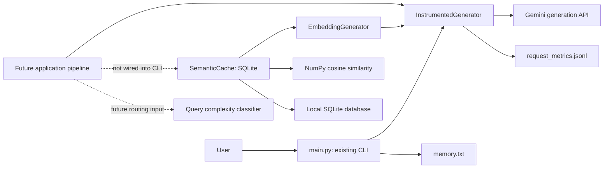

# LLM Cost Router

A Python project exploring how to reduce LLM API costs through measured requests and safe reuse of answers. The working application is a Gemini command line assistant. Embedding generation, semantic similarity search, and a persistent SQLite cache are implemented as separate modules; the cache is **not connected to the CLI yet**.

## Why this project?

Repeated questions can incur repeated generation costs, while different questions may need different models. LLM Cost Router aims to measure request cost and latency, reuse suitable answers through semantic caching, route requests by cost, and escalate when answer quality is insufficient. Today, measurement and the cache building blocks are implemented; routing, escalation, and a dashboard remain planned work.

## Implemented features

- Interactive CLI using `gemini-3.1-flash-lite`, with conversation history, local long term memory, `exit`, `clear`, and `memory` commands. Temporary HTTP 503 errors are retried.
- Request instrumentation for Gemini answer and memory summary calls: UTC timestamp, model, status, latency, SDK token counts, and estimated USD cost.
- `gemini-embedding-001` query embeddings with 768 dimensions and unit length NumPy normalization. Embedding requests use the same instrumentation.
- NumPy cosine similarity search with a configurable inclusive threshold (default `0.9`).
- A standalone SQLite semantic cache with TTL, namespace and embedding version scoping, duplicate protection, expiration cleanup, and explicit query and response eligibility.
- Standalone deterministic query complexity classification into simple or complex, with configurable weighted signals and explicit reasons.
- Offline tests, including an integration test that stores a mocked Gemini answer, reopens SQLite, and retrieves it using a similar query without another answer generation call.

## Architecture



The cache creates no answer: a caller must decide whether to use a hit or generate an answer, review that answer, and explicitly approve storage. The integration test exercises this sequence with mocked SDK responses; it is test-only orchestration.

## Technology

Python 3.14.5 is the version verified in the local virtual environment. The pinned runtime dependencies are `google-genai==2.29.0`, `python-dotenv==1.2.4`, `numpy==2.5.4`, and `streamlit==1.66.1`; `pytest==9.2.0` is pinned in `requirements-dev.txt`. Streamlit is installed but **no Streamlit application exists yet**. SQLite comes with Python. No PostgreSQL integration is implemented.

## Repository layout

```text
llm-cost-router/
├── main.py                     # Existing Gemini CLI and local memory
├── instrumentation.py          # SDK call timing, usage, pricing, JSONL records
├── model_pricing.json          # Configurable per-model USD rates
├── query_complexity.py         # Independent deterministic complexity classifier
├── complexity_config.py        # Validated classifier thresholds and weights
├── embeddings.py               # Gemini query embeddings and normalization
├── semantic_similarity.py      # In-memory cosine search
├── evaluate_similarity.py      # Offline pairwise evaluation runner
├── evaluation/                 # Labeled pairs and synthetic vector fixtures
├── cache_schema.py             # SQLite schema and transactional migration
├── cache_config.py             # Validated semantic threshold defaults
├── semantic_cache.py           # Persistent SQLite cache and eligibility
├── requirements.txt            # Pinned runtime dependencies
├── requirements-dev.txt        # Runtime dependencies plus pytest
├── pytest.ini                  # Collect tests/ by default
├── tests/                      # Mocked, offline unit and integration tests
├── test_history.py             # Legacy offline script
├── test_memory_quality.py      # Legacy offline script
└── test_memory.py              # Legacy script; avoid for offline runs
```

Local `.env`, `memory.txt`, `.venv/`, request metrics, and SQLite files are ignored by Git. `.env.example` is **not currently present** in this repository.

## Windows setup

From PowerShell:

```powershell
git clone https://github.com/omkharad100x/llm-cost-router.git
cd llm-cost-router
py -3.14 -m venv .venv
.\.venv\Scripts\python.exe -m pip install -r requirements-dev.txt
```

Use a Python 3.14 installation for the documented, locally verified environment. For CLI use alone, install `requirements.txt` instead. The repository pins package versions but has no transitive dependency lockfile.

Create a local `.env` in the repository root. The following is the safe template one would put in a future `.env.example`; it contains a placeholder only:

```dotenv
GEMINI_API_KEY=replace_with_your_own_key
```

The CLI loads `.env` with `python-dotenv` and requires `GEMINI_API_KEY`. Keep the real key only in the ignored local `.env`; never commit it. Running the CLI uses the live Gemini API and may incur charges:

```powershell
.\.venv\Scripts\python.exe main.py
```

Type a question to chat. Type `memory` to display saved memory, `clear` to clear recent conversation history, or `exit` to quit. The CLI creates and reads local `memory.txt`; its Gemini summaries may update that file. It writes request metadata to the ignored `request_metrics.jsonl`.

Run the complete offline test suite without collecting root level live API scripts:

```powershell
.\.venv\Scripts\python.exe -B -m pytest tests -q -p no:cacheprovider
```

`pytest.ini` also sets `tests/` as the default test directory. The integration test in `tests/test_cache_integration.py` uses mocked Gemini generation and embedding responses plus a temporary SQLite database; it makes no live API calls.

## Semantic cache and safety

`SemanticCache.lookup(query, eligibility=...)` embeds an approved query, compares it with unexpired entries in the same namespace and embedding configuration, and returns a `CacheLookup` containing hit status, cached response, matched query, similarity score, and entry ID. `save(..., eligibility=..., response_eligibility=...)` stores an approved query and answer with a configurable TTL (default one day). `remove_expired()` and `clear()` manage local entries.

Eligibility is **denied by default**. A trusted caller must provide `QueryEligibility` for the exact query, affirming that it is independent of conversation context, non-sensitive, time independent, and independent of external state. Storage also requires `ResponseEligibility` for the exact response, affirming API success, absence of a safety refusal, and non-sensitive content. These objects are attestations, not automatic safety classifiers. Failed or refused answers, personal data, follow-ups, and changing facts must not be approved for reuse. The current CLI does not make these assessments or use the cache.

The cache stores query and answer text and float32 embeddings in a local SQLite file. Use an ignored `.db`, `.sqlite`, or `.sqlite3` path and protect the file with appropriate local access controls. Similarity does not prove that two questions deserve the same answer; the threshold has not been calibrated on a labeled dataset.

## Cache threshold configuration

`cache_config.py` centralizes the default in `CacheConfig(similarity_threshold=0.9)`
and shares threshold validation with the cache and similarity search. Pass a
configuration object to choose an application default; no environment variable,
extra dependency, or pricing-file change is required.

```python
from cache_config import CacheConfig
from semantic_cache import SemanticCache

# embedder is an existing EmbeddingGenerator; query_review is a trusted
# QueryEligibility assessment bound to this exact query.
config = CacheConfig(similarity_threshold=0.92)
with SemanticCache("semantic_cache.sqlite3", embedder, config=config) as cache:
    result = cache.lookup(query, eligibility=query_review)  # Uses 0.92.
    strict_result = cache.lookup(
        query, eligibility=query_review, threshold=0.97,
    )  # This lookup only; the cache default remains 0.92.
```

Precedence is **lookup override > constructor `threshold` > configuration default**.
The existing `SemanticCache(path, embedder, threshold=0.95)` form remains supported.
Without customization, the cache and direct `find_most_similar` calls retain
the shared `0.9` default. Direct similarity searches also accept `threshold=...`.

Thresholds must be finite real numbers in the inclusive range `[-1, 1]`.
Booleans, strings, `None`, NaN, infinities, and out-of-range values raise
`ValueError`; invalid lookup overrides fail before embedding or database access.
Omit the argument to use the default. Zero and negative thresholds are valid
and are never treated as missing. A score equal to the threshold is accepted;
lower thresholds admit more matches and require careful quality evaluation.
Overrides do not change eligibility requirements, stored entries, or TTLs.
Threshold configuration is supplied in Python and is not persisted in SQLite.

## Cache versioning, migration, and invalidation

There are two independent versions:

- **SQLite schema version 2** (`PRAGMA user_version`) describes the database layout.
- **Application cache version** (`CacheConfig(cache_version="v1")`) describes answer
  compatibility. Bump it when prompt, answer-generation, or application policy
  changes make existing answers unsuitable.

The schema adds `cache_version` and `embedding_config` to each entry and to its
uniqueness constraint. Compatibility includes namespace, embedding model,
caller-assigned embedding version, task type, dimensions, storage dtype,
eligibility version, application cache version, and canonical JSON metadata for
normalization and preprocessing. Task and preprocessing/normalization identifiers
come from `embeddings.py`. Threshold and TTL do not change embedding compatibility.

```python
from cache_config import CacheConfig
from semantic_cache import SemanticCache

# Supply the existing EmbeddingGenerator instance.
with SemanticCache(
    "semantic_cache.sqlite3", embedder,
    namespace="public-faq", config=CacheConfig(cache_version="v2"),
    embedding_version="v1",
) as cache:
    result = cache.lookup(query, eligibility=query_review)
    # Selectors are examples: invoke only the invalidation you intend.
    removed = cache.invalidate(entry_id=entry_id)
    removed = cache.invalidate(namespace="retired-faq")
    removed = cache.invalidate(
        embedding_model="gemini-embedding-001", embedding_version="v1",
    )
    removed = cache.invalidate(cache_version="v1")
    expired = cache.remove_expired()
```

An explicit constructor `cache_version="v2"` overrides the configuration object's
version. Versions must be nonempty strings. Changing versions excludes old entries
without deleting them; identical queries may coexist in different versions.
Existing instances retain their configured version. This is per-instance
compatibility scoping, not a database-wide switch. Use explicit invalidation to
remove retired entries, including those visible to older instances.

`invalidate()` deletes matching rows and returns their count. Selectors combine
with AND. Entry ID, embedding model/version, and cache version filters default to
the instance's namespace; an explicit namespace targets that namespace instead.
At least one selector is required. `clear()` still clears the current namespace
across all versions, and `remove_expired()` removes entries whose expiry is at or
before the current time, across versions in that namespace. Other namespaces
are preserved. SQL values are parameterized.

Lookup re-reads the selected row after similarity search and returns an
`invalidated` miss if it was removed or changed. The final read defines the
concurrent lookup's observation point: an invalidation completed before that
read is honored. A deletion after that read cannot revoke a response already
being returned. Invalidation removes existing rows; it does not install a
permanent ban or cancel in-flight saves. A newly reviewed response can be saved
again later.

### Migration and compatibility

On opening a recognized schema version 1 database, the cache migrates it
automatically inside one `BEGIN IMMEDIATE` transaction. The table is rebuilt to
extend its uniqueness constraint; every original field, ID, vector byte, namespace,
and timestamp is copied, including expired entries. Legacy entries receive
application version `v1` and the frozen original embedding configuration, even
when the opener requests a newer application version. A failure rolls back the
table rebuild and schema version together.

Back up an existing database before upgrading, and close older application
processes during migration. Unknown schema versions, unrecognized version 1 table
definitions, and customized version 1 databases with extra tables, indexes, views,
or triggers are refused for manual migration. They are not reset. This migration
does not support downgrade; older code rejects schema version 2.

The current embedding module still uses `gemini-embedding-001`, 768 dimensions,
and `SEMANTIC_SIMILARITY`. `embedding_version` is an application-maintained
compatibility marker, not an automatically discovered Google model revision.
Custom injected embedders must honor that contract. Stored vectors cannot prove
which model produced them. Namespace scoping is not authentication.

## Near-miss and false-hit evaluation

`evaluation/query_pairs.json` contains 22 reviewed query pairs with stable IDs,
categories, `SAFE_MATCH` or `MUST_NOT_MATCH` labels, and explanations.
Eight equivalent pairs cover paraphrases and matching facts. Fourteen negative
pairs include negation, quantities, dates/years, entities/names, operations,
changed conditions/constraints, and unrelated controls. Labels describe whether
the questions can share an answer; they do not grant cache eligibility.

Run the deterministic evaluation from the repository root:

```powershell
.\.venv\Scripts\python.exe -B evaluate_similarity.py
.\.venv\Scripts\python.exe -B evaluate_similarity.py --threshold 0.95
```

The runner uses `semantic_similarity.find_most_similar` and shared threshold
validation. The default comes from `cache_config.DEFAULT_CONFIG` (currently `0.9`).
It compares each pair independently, with the second query as its single stored
candidate, and prints JSON containing the threshold, embedding source, metrics,
and every pair's score, prediction, label, and explanation.

`evaluation/synthetic_embeddings.json` supplies fixed normalized 2D vectors.
These are **hand-assigned test fixtures, not Gemini embeddings**. They deliberately
include high-scoring negative pairs and lower-scoring equivalent pairs so that
false positives and false negatives remain visible. Changing labels never
changes vectors. No SDK client, API call, secret, or cache database is used.

At the default threshold, these fixtures yield:

| TP | FP | TN | FN | Precision | Recall | False-hit rate |
| --- | --- | --- | --- | --- | --- | --- |
| 6 | 7 | 7 | 2 | 46.15% | 75.00% | 50.00% |

`SAFE_MATCH` is the positive class. Precision is `TP / (TP + FP)`,
recall is `TP / (TP + FN)`, and false-hit rate is the false-positive rate
`FP / (FP + TN)`: the fraction of negative pairs incorrectly accepted.
It differs from the fraction of accepted matches that are wrong (`1 - precision`).
Undefined ratios are JSON `null`. Malformed annotations, missing or invalid
vectors, and invalid thresholds fail explicitly rather than skipping examples.

To evaluate another **already generated** vector set offline, pass
`--embeddings path/to/vectors.json`. Use the supplied fixture's versioned JSON
format (`schema_version`, `source`, and an `embeddings` mapping from exact query
text to vectors), with all vectors normalized and dimensionally compatible.
An alternate labeled dataset can be supplied with `--dataset path/to/pairs.json`.
The runner does not generate vectors.

These fixture metrics verify evaluation plumbing only. They do not estimate
Gemini accuracy, establish a production threshold, or evaluate cache eligibility,
multi-candidate retrieval, or factual answer quality. A representative, independently
reviewed dataset and real precomputed embeddings are needed for calibration.
High cosine similarity alone cannot establish answer equivalence. The existing
cache safety requirements continue to apply.

## Cost and embedding measurement

`InstrumentedGenerator` records each Gemini request attempt to JSONL. It reads usage metadata returned by the SDK and estimates cost using `model_pricing.json` rates in USD per million tokens. Unknown token counts or costs remain JSON `null`; a reported zero stays zero. Estimates are not invoices, and pricing should be reviewed before relying on them. Records omit prompt, answer, memory, vector, and API key content.

`EmbeddingGenerator` requests `gemini-embedding-001` with the `SEMANTIC_SIMILARITY` task and 768 output dimensions, then normalizes the vector for cosine search. Embedding token usage comes from SDK embedding statistics when supplied. If statistics are absent, token count and estimated embedding cost remain unavailable; the code does not guess tokens from text length.

## Query complexity classification

`query_complexity.classify_query` independently classifies a query as `simple`
or `complex` using deterministic English rules and the Python standard library.
It returns an immutable `ComplexityResult` with `label`, integer `score`,
weighted `signals`, `reasons`, `word_count`, and approximate `instruction_count`.
The module does not read configuration files, secrets, or memory.

```python
from complexity_config import ComplexityConfig
from query_complexity import classify_query

result = classify_query("Write a Python function to merge two sorted lists.")
print(result.label, result.score, result.reasons)  # complex, 3, coding reason

config = ComplexityConfig(complex_threshold=4, long_query_words=160)
result = classify_query("Prove this statement.", config=config)  # simple at score 3
```

Each detected rule contributes once, in a fixed order. The label is `complex`
when the score is at least `complex_threshold` (default `3`).

| Signal | Default weight | Detection |
| --- | --- | --- |
| Length | 1 | At least 120 words |
| Multiple tasks | 3 | At least two distinct instruction-like clauses |
| Multi-step work | 3 | Step-by-step request, or first followed by then |
| Reasoning | 3 | Proof, derivation, justification, or explicit reasoning cues |
| Coding | 3 | Code generation, debugging, or refactoring request patterns |
| Advanced math | 3 | Symbolic, probabilistic, or other advanced math request patterns |
| Analysis | 3 | Analysis/comparison/optimization action with a relevant subject |
| Explanation | 1 | Detailed explanation, examples, explain why/how |
| Context | 1 | Explicit supplied-context/constraint phrases or fenced code |

Length alone remains below the default complex threshold. Basic arithmetic,
definitions, and straightforward translation can remain simple. Task counting
splits on sentence/list boundaries and connectors, then counts unique clauses
starting with a recognized instruction or question cue.

`ComplexityConfig` validates positive integer thresholds, a task minimum of at
least two, and an immutable tuple of weights defining every supported signal.
Weights are nonnegative integers; zero disables a signal's contribution.
Use `dataclasses.replace` and a new tuple to customize weights:

```python
from dataclasses import replace
from complexity_config import DEFAULT_COMPLEXITY_CONFIG

config = replace(
    DEFAULT_COMPLEXITY_CONFIG,
    weights=tuple(
        (name, 4 if name == "coding" else weight)
        for name, weight in DEFAULT_COMPLEXITY_CONFIG.weights
    ),
)
```

Empty, non-string, or punctuation-only queries and invalid configurations raise
`ValueError`. No confidence probability is reported: the score is heuristic
evidence, without calibration against a labeled complexity dataset.

Examples with default settings:

| Query | Label |
| --- | --- |
| What is the capital of France? | simple |
| Calculate 2 + 2. | simple |
| First calculate the total, then explain the result. | complex |
| Write a Python function to merge two sorted lists. | complex |
| Calculate the probability of exactly two heads in five tosses. | complex |

The classifier is ready to be called by a future pipeline, but is not connected
to the CLI, cache, or Gemini model selection. Complexity does not establish
cache eligibility or answer quality. Rules are English phrase heuristics:
unusual wording, negation, quoted instructions, code content, and implicit
reasoning can cause incorrect classifications. Instruction counts approximate
structure rather than understanding distinct tasks. Rule weights and thresholds
need calibration before using them for routing decisions.

The complete offline suite includes `tests/test_query_complexity.py`, covering
simple and complex requests, long straightforward queries, configuration, exact
boundaries, determinism, and execution with network connections disabled.

## Status and next steps

The CLI, instrumentation, embeddings, similarity search, standalone cache, and query complexity classifier are implemented and covered by offline tests. The mocked integration test demonstrates one generated answer followed by a semantic hit after reopening SQLite. Production cache orchestration, automatic eligibility policy, cost aware model routing, quality based escalation, analytics, Streamlit UI, PostgreSQL, and public deployment are future work.

Next priorities are to define a trustworthy cache eligibility workflow, connect cache lookup and reviewed storage to an application pipeline, avoid embedding the original query twice on a miss followed by save, and measure hit quality and cost savings. The current cache scans eligible vectors in linear time, keeps plaintext local data, and has no vector index or size based eviction. Schema migration currently supports only the original version 1 schema to version 2. The CLI's JSONL recorder is intended for local single process use.
