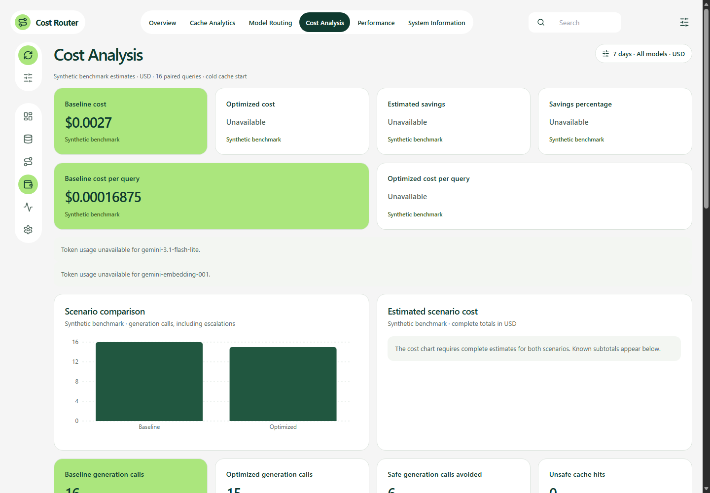

# Semantic Caching & Cost-Optimized LLM Routing

When can a repeated question safely reuse an answer, and when is a second model call worth its cost? This Python project tests those decisions with reviewed query pairs, scripted Gemini responses, and a ledger of every measured request. The public dashboard lets you inspect the results without an API key.

[Open the live dashboard](https://semantic-caching-cost-optimized-llm.vercel.app/) · [View the workspace JSON](https://semantic-caching-cost-optimized-llm.vercel.app/api/workspace) · [Architecture and request flow](docs/architecture.md) · [GitHub repository](https://github.com/omkharad100x/semantic-caching-cost-optimized-llm-routing)

## What the demo shows

The saved benchmark runs the same 16 queries through a large-model baseline and a cache-first workflow. The baseline made 16 mock generation calls. The optimized workflow reused six reviewed answers and made 15 generation calls, including five escalations. Those escalations offset five of the six avoided initial calls.

The baseline estimate is **$0.0027**. The optimized **known subtotal is $0.001725**. Twenty embedding calls and one generation lack the usage needed to price them, so optimized total cost, average cost per query, and monetary savings are unavailable. These figures come from synthetic fixtures. Production spending and real provider latency have not been measured by the demo. [Saved benchmark report](benchmark_report.json)

## Screenshot



Captured from the public demo on November 7, 2026. The generation chart remains meaningful even when the cost comparison is incomplete.

## Demo walkthrough

| Section | What to look for |
| --- | --- |
| **Overview** | Start with the source indicators. The hosted benchmark is ready, local request history is unavailable, and live telemetry is disconnected. |
| **Cache Analytics** | Select the 0.9 threshold. In this separate 22-pair experiment, 12 pairs hit, including six false hits. A high similarity score can still select a wrong answer. |
| **Model Routing** | Follow the eight routing fixtures from initial selection to final answer. Six queries start small, two start large, and four trigger escalation. |
| **Cost Analysis** | Compare the 16 paired queries above. Read the known subtotal alongside the count of requests with unknown costs before interpreting the savings field. |
| **Performance** | Compare local mock request timings and final heuristic pass rates. Eight of 16 baseline answers passed and ten of 16 optimized answers passed. The evaluator cannot establish factual accuracy. |
| **System Information** | Inspect configured model names, thresholds, and cache version. **Not probed** means the refresh did not open a database connection. |

Date, model, and currency controls apply to available historical observations. The public API omits local history. The benchmark panels retain the full saved workload and use USD.

## How it works

- **Semantic cache.** A caller explicitly reviews the query and response for reuse. Eligible queries get a normalized 768-dimensional `gemini-embedding-001` vector. NumPy cosine search considers unexpired entries in the same namespace and compatible embedding configuration. The default threshold is inclusive at 0.9. The caller must exclude sensitive, context-dependent, or time-sensitive queries and withhold approval for failed answers or safety refusals.
- **Model routing and escalation.** A deterministic classifier uses task structure, reasoning, code, and mathematical signals. Simple queries default to `gemini-3.1-flash-lite` and complex queries to `gemini-3.8-flash`. A small-model answer that fails the quality check can trigger one large-model attempt. Quality checks cover presence, relevance, completeness, structure, uncertainty, and error indicators.
- **Observability.** Instrumentation records model, request kind, UTC time, latency, status, token counts, and estimated cost. Decimal accounting separates ordinary input, provider-cached input, and output including thoughts. Missing usage or pricing remains unknown.
- **Application boundaries.** The benchmark composes cache, routing, evaluation, and escalation. The standalone Gemini CLI uses its own conversation history and long-term memory. The hosted dashboard reads the saved benchmark through a Python API. [Component map](docs/architecture.md)

The Python components use the Google Gen AI SDK and NumPy, with SQLite or optional PostgreSQL storage via Psycopg 3. Tests use pytest. The public UI uses React, TypeScript, Vite, and Recharts. Streamlit provides a separate local dashboard.

## Run locally on Windows

The project has been tested with Python 3.14.5 and Node.js 24. Run these PowerShell commands to install the local dependencies and start the React dashboard:

```powershell
git clone https://github.com/omkharad100x/semantic-caching-cost-optimized-llm-routing.git
cd semantic-caching-cost-optimized-llm-routing
py -3.14 -m venv .venv
.\.venv\Scripts\python.exe -m pip install -r requirements-dev.txt
cd frontend
npm ci
npm run dev
```

Open [the local React dashboard](http://127.0.0.1:5173/). The Vite middleware uses the repository's virtual environment to serve the workspace API. For the local Streamlit view, run the following from the repository root:

```powershell
.\.venv\Scripts\python.exe -m streamlit run dashboard.py
```

The dashboard and offline benchmarks need no Gemini key. To run the separate interactive CLI, configure `GEMINI_API_KEY` privately and run `.\.venv\Scripts\python.exe main.py` from the repository root. The CLI uses Google’s API, so provider terms, quotas, and charges apply. It stores local memory in `memory.txt`.

## Test and reproduce

From the repository root:

```powershell
.\.venv\Scripts\python.exe -m pytest tests -q
.\.venv\Scripts\python.exe evaluate_similarity.py --threshold 0.9
.\.venv\Scripts\python.exe benchmarks.py --output benchmark-report-local.json
npm --prefix frontend run build
```

Use a new filename for benchmark output. The runner refuses to overwrite an existing report. The dashboards read `benchmark_report.json`. Fixture decisions and counts are reproducible, while measured timings vary per run. The verified offline suite has **950 passing tests and one skipped opt-in PostgreSQL test**.

## Deployment and storage status

Vercel builds the React assets into `frontend/dist`. The browser calls same-origin `GET /api/workspace`, and the standard-library Python function returns the validated workspace projection. The hosted endpoint has returned production JSON successfully. Unsupported methods return HTTP 405 with `Allow: GET, HEAD`. Serving this read-only monitoring view requires neither a Gemini request nor a database probe. [Deployment configuration](vercel.json) · [API contract and privacy](docs/architecture.md#monitoring-api)

SQLite is the default cache backend. The optional PostgreSQL adapter supports verified TLS through the Supabase Transaction Pooler. Its schema and concurrency behavior have offline coverage. Real PostgreSQL integration is pending local `verify-full` TLS configuration. Hosted database connectivity, production migrations, and effective Supabase role grants remain unverified. [Database configuration and migration guide](docs/database.md)

The project targets a **₹0 budget**. Vercel Hobby is limited to personal, noncommercial use and includes usage limits. Supabase Free also has quotas, including database size and egress. The demo needs no paid add-on, IPv4 add-on, trial, or plan upgrade. Check current limits before enabling services. [Vercel Hobby terms and limits](https://vercel.com/docs/plans/hobby) · [Supabase Free plan and quotas](https://supabase.com/docs/guides/platform/billing-on-supabase)
