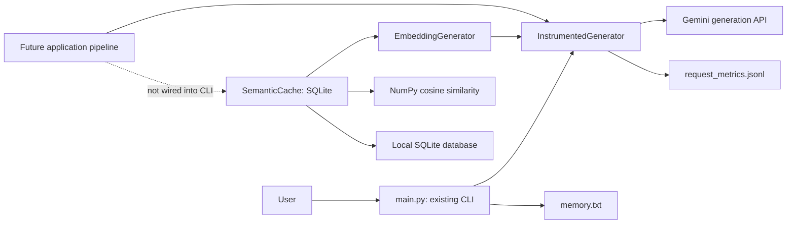

# LLM Cost Router

A Python project exploring how to reduce LLM API costs through measured requests and safe reuse of answers. The working application is a Gemini command line assistant. Embedding generation, semantic similarity search, and a persistent SQLite cache are implemented as separate modules; the cache is **not connected to the CLI yet**.

## Why this project?

Repeated questions can incur repeated generation costs, while different questions may need different models. LLM Cost Router aims to measure request cost and latency, reuse suitable answers through semantic caching, route requests by cost, and escalate when answer quality is insufficient. Today, measurement and the cache building blocks are implemented; routing, escalation, and a dashboard remain planned work.

## Implemented features

- Interactive CLI using `gemini-3.1-flash-lite`, with conversation history, local long term memory, `exit`, `clear`, and `memory` commands. Temporary HTTP 503 errors are retried.
- Request instrumentation for Gemini answer and memory summary calls: UTC timestamp, model, status, latency, SDK token counts, and estimated USD cost.
- `gemini-embedding-001` query embeddings with 768 dimensions and unit length NumPy normalization. Embedding requests use the same instrumentation.
- NumPy cosine similarity search with a configurable inclusive threshold (default `0.9`).
- A standalone SQLite semantic cache with TTL, namespace and embedding version scoping, duplicate protection, expiration cleanup, and explicit query and response eligibility.
- Offline tests, including an integration test that stores a mocked Gemini answer, reopens SQLite, and retrieves it using a similar query without another answer generation call.

## Architecture



The cache creates no answer: a caller must decide whether to use a hit or generate an answer, review that answer, and explicitly approve storage. The integration test exercises this sequence with mocked SDK responses; it is test-only orchestration.

## Technology

Python 3.14.5 is the version verified in the local virtual environment. The pinned runtime dependencies are `google-genai==2.29.0`, `python-dotenv==1.2.4`, `numpy==2.5.4`, and `streamlit==1.66.1`; `pytest==9.2.0` is pinned in `requirements-dev.txt`. Streamlit is installed but **no Streamlit application exists yet**. SQLite comes with Python. No PostgreSQL integration is implemented.

## Repository layout

```text
llm-cost-router/
├── main.py                     # Existing Gemini CLI and local memory
├── instrumentation.py          # SDK call timing, usage, pricing, JSONL records
├── model_pricing.json          # Configurable per-model USD rates
├── embeddings.py               # Gemini query embeddings and normalization
├── semantic_similarity.py      # In-memory cosine search
├── semantic_cache.py           # Persistent SQLite cache and eligibility
├── requirements.txt            # Pinned runtime dependencies
├── requirements-dev.txt        # Runtime dependencies plus pytest
├── pytest.ini                  # Collect tests/ by default
├── tests/                      # Mocked, offline unit and integration tests
├── test_history.py             # Legacy offline script
├── test_memory_quality.py      # Legacy offline script
└── test_memory.py              # Legacy script; avoid for offline runs
```

Local `.env`, `memory.txt`, `.venv/`, request metrics, and SQLite files are ignored by Git. `.env.example` is **not currently present** in this repository.

## Windows setup

From PowerShell:

```powershell
git clone https://github.com/omkharad100x/llm-cost-router.git
cd llm-cost-router
py -3.14 -m venv .venv
.\.venv\Scripts\python.exe -m pip install -r requirements-dev.txt
```

Use a Python 3.14 installation for the documented, locally verified environment. For CLI use alone, install `requirements.txt` instead. The repository pins package versions but has no transitive dependency lockfile.

Create a local `.env` in the repository root. The following is the safe template one would put in a future `.env.example`; it contains a placeholder only:

```dotenv
GEMINI_API_KEY=replace_with_your_own_key
```

The CLI loads `.env` with `python-dotenv` and requires `GEMINI_API_KEY`. Keep the real key only in the ignored local `.env`; never commit it. Running the CLI uses the live Gemini API and may incur charges:

```powershell
.\.venv\Scripts\python.exe main.py
```

Type a question to chat. Type `memory` to display saved memory, `clear` to clear recent conversation history, or `exit` to quit. The CLI creates and reads local `memory.txt`; its Gemini summaries may update that file. It writes request metadata to the ignored `request_metrics.jsonl`.

Run the complete offline test suite without collecting root level live API scripts:

```powershell
.\.venv\Scripts\python.exe -B -m pytest tests -q -p no:cacheprovider
```

`pytest.ini` also sets `tests/` as the default test directory. The integration test in `tests/test_cache_integration.py` uses mocked Gemini generation and embedding responses plus a temporary SQLite database; it makes no live API calls.

## Semantic cache and safety

`SemanticCache.lookup(query, eligibility=...)` embeds an approved query, compares it with unexpired entries in the same namespace and embedding configuration, and returns a `CacheLookup` containing hit status, cached response, matched query, similarity score, and entry ID. `save(..., eligibility=..., response_eligibility=...)` stores an approved query and answer with a configurable TTL (default one day). `remove_expired()` and `clear()` manage local entries.

Eligibility is **denied by default**. A trusted caller must provide `QueryEligibility` for the exact query, affirming that it is independent of conversation context, non-sensitive, time independent, and independent of external state. Storage also requires `ResponseEligibility` for the exact response, affirming API success, absence of a safety refusal, and non-sensitive content. These objects are attestations, not automatic safety classifiers. Failed or refused answers, personal data, follow-ups, and changing facts must not be approved for reuse. The current CLI does not make these assessments or use the cache.

The cache stores query and answer text and float32 embeddings in a local SQLite file. Use an ignored `.db`, `.sqlite`, or `.sqlite3` path and protect the file with appropriate local access controls. Similarity does not prove that two questions deserve the same answer; the threshold has not been calibrated on a labeled dataset.

## Cost and embedding measurement

`InstrumentedGenerator` records each Gemini request attempt to JSONL. It reads usage metadata returned by the SDK and estimates cost using `model_pricing.json` rates in USD per million tokens. Unknown token counts or costs remain JSON `null`; a reported zero stays zero. Estimates are not invoices, and pricing should be reviewed before relying on them. Records omit prompt, answer, memory, vector, and API key content.

`EmbeddingGenerator` requests `gemini-embedding-001` with the `SEMANTIC_SIMILARITY` task and 768 output dimensions, then normalizes the vector for cosine search. Embedding token usage comes from SDK embedding statistics when supplied. If statistics are absent, token count and estimated embedding cost remain unavailable; the code does not guess tokens from text length.

## Status and next steps

The CLI, instrumentation, embeddings, similarity search, and standalone cache are implemented and covered by offline tests. The mocked integration test demonstrates one generated answer followed by a semantic hit after reopening SQLite. Production cache orchestration, automatic eligibility policy, cost aware model routing, quality based escalation, analytics, Streamlit UI, PostgreSQL, and public deployment are future work.

Next priorities are to define a trustworthy cache eligibility workflow, connect cache lookup and reviewed storage to an application pipeline, avoid embedding the original query twice on a miss followed by save, and measure hit quality and cost savings. The current cache scans eligible vectors in linear time, keeps plaintext local data, and has no vector index, size based eviction, or schema migration. The CLI's JSONL recorder is intended for local single process use.
