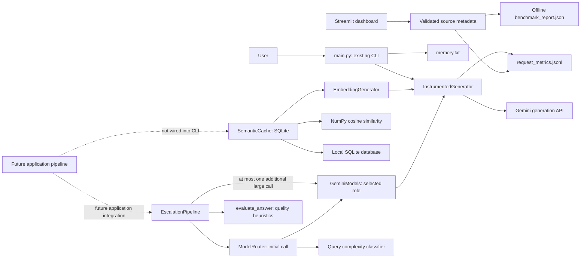

# LLM Cost Router

A Python project exploring how to reduce LLM API costs through measured requests and safe reuse of answers. The working application is a Gemini command line assistant. Embedding generation, semantic similarity search, and a persistent SQLite cache are implemented as separate modules; the cache is **not connected to the CLI yet**.

## Why this project?

Repeated questions can incur repeated generation costs, while different questions may need different models. LLM Cost Router aims to measure request cost and latency, reuse suitable answers through semantic caching, route requests by cost, and escalate when answer quality is insufficient. Today, measurement, cache building blocks, complexity-first model routing, and standalone quality-based escalation are implemented. The read-only dashboard displays offline cache, routing and paired cost results alongside available historical request records.

## Implemented features

- Interactive CLI using `gemini-3.1-flash-lite`, with conversation history, local long term memory, `exit`, `clear`, and `memory` commands. Temporary HTTP 503 errors are retried.
- Request instrumentation for Gemini answer and memory summary calls: UTC timestamp, model, status, latency, SDK token counts, and estimated USD cost.
- `gemini-embedding-001` query embeddings with 768 dimensions and unit length NumPy normalization. Embedding requests use the same instrumentation.
- NumPy cosine similarity search with a configurable inclusive threshold (default `0.9`).
- A standalone SQLite semantic cache with TTL, namespace and embedding version scoping, duplicate protection, expiration cleanup, and explicit query and response eligibility.
- Independent deterministic answer-quality checks with weighted criteria, configurable acceptance, and explicit factual-verification limits.
- A standalone escalation pipeline that evaluates routed answers, escalates a failed small-model answer once, and retains both attempts and complete metric totals.
- A standalone complexity-first router: simple queries use the small role and complex queries use the large role, with explicit cost availability and routing reasons.
- A reusable Gemini model layer with explicit small/large roles, environment-configurable model IDs, structured responses, and shared instrumentation.
- Standalone deterministic query complexity classification into simple or complex, with configurable weighted signals and explicit reasons.
- Offline tests, including an integration test that stores a mocked Gemini answer, reopens SQLite, and retrieves it using a similar query without another answer generation call.
- Reproducible offline cache, routing, and escalation benchmarks with JSON reports, explicit incomplete costs, and measured local mock-call timings.
- A six-section local dashboard with cache and routing analytics, source labels, refresh, and explicit availability states.

## Architecture



The cache creates no answer: a caller must decide whether to use a hit or generate an answer, review that answer, and explicitly approve storage. The integration test exercises this sequence with mocked SDK responses; it is test-only orchestration.

## Technology

Python 3.14.5 is the version verified in the local virtual environment. The pinned runtime dependencies are `google-genai==2.29.0`, `python-dotenv==1.2.4`, `numpy==2.5.4`, and `streamlit==1.66.1`; `pytest==9.2.0` is pinned in `requirements-dev.txt`. Streamlit powers the local, read-only dashboard. SQLite comes with Python. No PostgreSQL integration is implemented.

## Repository layout

```text
llm-cost-router/
├── main.py                     # Existing Gemini CLI and local memory
├── dashboard.py                # Local Streamlit entry point
├── dashboard_ui.py             # Navigation and presentation
├── dashboard_data.py           # Read-only source loading and metadata validation
├── assets/dashboard.css        # Scoped, responsive dashboard styles
├── .streamlit/config.toml      # Dark theme and loopback-only local server defaults
├── benchmarks.py              # Offline experiments and JSON/human summaries
├── benchmark_report.json       # Sample synthetic run; timings vary by machine
├── escalation.py              # One quality-based escalation and attempt totals
├── answer_evaluator.py         # Independent heuristic answer-quality assessment
├── evaluation_config.py        # Quality weights, threshold, and acceptance rules
├── model_router.py             # Complexity-first routing and decision metadata
├── gemini_models.py            # Explicit small/large calls and structured responses
├── model_config.py             # Model-name environment configuration
├── instrumentation.py          # SDK call timing, usage, pricing, JSONL records
├── model_pricing.json          # Verified standard text USD rates and validity
├── money.py                    # Exact Decimal arithmetic and shared money display
├── query_complexity.py         # Independent deterministic complexity classifier
├── complexity_config.py        # Validated classifier thresholds and weights
├── embeddings.py               # Gemini query embeddings and normalization
├── semantic_similarity.py      # In-memory cosine search
├── evaluate_similarity.py      # Offline pairwise evaluation runner
├── evaluation/                 # Labeled pairs, vectors, and benchmark_fixtures.json
├── cache_schema.py             # SQLite schema and transactional migration
├── cache_config.py             # Validated semantic threshold defaults
├── semantic_cache.py           # Persistent SQLite cache and eligibility
├── requirements.txt            # Pinned runtime dependencies
├── requirements-dev.txt        # Runtime dependencies plus pytest
├── pytest.ini                  # Collect tests/ by default
├── tests/                      # Mocked, offline unit and integration tests
├── test_history.py             # Legacy offline script
├── test_memory_quality.py      # Legacy offline script
└── test_memory.py              # Legacy script; avoid for offline runs
```

Local `.env`, `memory.txt`, `.venv/`, request metrics, and SQLite files are ignored by Git. `.env.example` is **not currently present** in this repository.

## Windows setup

From PowerShell:

```powershell
git clone https://github.com/omkharad100x/llm-cost-router.git
cd llm-cost-router
py -3.14 -m venv .venv
.\.venv\Scripts\python.exe -m pip install -r requirements-dev.txt
```

Use a Python 3.14 installation for the documented, locally verified environment. For CLI use alone, install `requirements.txt` instead. The repository pins package versions but has no transitive dependency lockfile.

Create a local `.env` in the repository root. The following is the safe template one would put in a future `.env.example`; it contains a placeholder only:

```dotenv
GEMINI_API_KEY=replace_with_your_own_key
```

The CLI loads `.env` with `python-dotenv` and requires `GEMINI_API_KEY`. Keep the real key only in the ignored local `.env`; never commit it. Running the CLI uses the live Gemini API and may incur charges:

```powershell
.\.venv\Scripts\python.exe main.py
```

Type a question to chat. Type `memory` to display saved memory, `clear` to clear recent conversation history, or `exit` to quit. The CLI creates and reads local `memory.txt`; its Gemini summaries may update that file. It writes request metadata to the ignored `request_metrics.jsonl`.

Run the complete offline test suite without collecting root level live API scripts:

```powershell
.\.venv\Scripts\python.exe -B -m pytest tests -q -p no:cacheprovider
```

`pytest.ini` also sets `tests/` as the default test directory. The integration test in `tests/test_cache_integration.py` uses mocked Gemini generation and embedding responses plus a temporary SQLite database; it makes no live API calls.

## Semantic cache and safety

`SemanticCache.lookup(query, eligibility=...)` embeds an approved query, compares it with unexpired entries in the same namespace and embedding configuration, and returns a `CacheLookup` containing hit status, cached response, matched query, similarity score, and entry ID. `save(..., eligibility=..., response_eligibility=...)` stores an approved query and answer with a configurable TTL (default one day). `remove_expired()` and `clear()` manage local entries.

Eligibility is **denied by default**. A trusted caller must provide `QueryEligibility` for the exact query, affirming that it is independent of conversation context, non-sensitive, time independent, and independent of external state. Storage also requires `ResponseEligibility` for the exact response, affirming API success, absence of a safety refusal, and non-sensitive content. These objects are attestations, not automatic safety classifiers. Failed or refused answers, personal data, follow-ups, and changing facts must not be approved for reuse. The current CLI does not make these assessments or use the cache.

The cache stores query and answer text and float32 embeddings in a local SQLite file. Use an ignored `.db`, `.sqlite`, or `.sqlite3` path and protect the file with appropriate local access controls. Similarity does not prove that two questions deserve the same answer; the threshold has not been calibrated on a labeled dataset.

## Cache threshold configuration

`cache_config.py` centralizes the default in `CacheConfig(similarity_threshold=0.9)`
and shares threshold validation with the cache and similarity search. Pass a
configuration object to choose an application default; no environment variable,
extra dependency, or pricing-file change is required.

```python
from cache_config import CacheConfig
from semantic_cache import SemanticCache

# embedder is an existing EmbeddingGenerator; query_review is a trusted
# QueryEligibility assessment bound to this exact query.
config = CacheConfig(similarity_threshold=0.92)
with SemanticCache("semantic_cache.sqlite3", embedder, config=config) as cache:
    result = cache.lookup(query, eligibility=query_review)  # Uses 0.92.
    strict_result = cache.lookup(
        query, eligibility=query_review, threshold=0.97,
    )  # This lookup only; the cache default remains 0.92.
```

Precedence is **lookup override > constructor `threshold` > configuration default**.
The existing `SemanticCache(path, embedder, threshold=0.95)` form remains supported.
Without customization, the cache and direct `find_most_similar` calls retain
the shared `0.9` default. Direct similarity searches also accept `threshold=...`.

Thresholds must be finite real numbers in the inclusive range `[-1, 1]`.
Booleans, strings, `None`, NaN, infinities, and out-of-range values raise
`ValueError`; invalid lookup overrides fail before embedding or database access.
Omit the argument to use the default. Zero and negative thresholds are valid
and are never treated as missing. A score equal to the threshold is accepted;
lower thresholds admit more matches and require careful quality evaluation.
Overrides do not change eligibility requirements, stored entries, or TTLs.
Threshold configuration is supplied in Python and is not persisted in SQLite.

## Cache versioning, migration, and invalidation

There are two independent versions:

- **SQLite schema version 2** (`PRAGMA user_version`) describes the database layout.
- **Application cache version** (`CacheConfig(cache_version="v1")`) describes answer
  compatibility. Bump it when prompt, answer-generation, or application policy
  changes make existing answers unsuitable.

The schema adds `cache_version` and `embedding_config` to each entry and to its
uniqueness constraint. Compatibility includes namespace, embedding model,
caller-assigned embedding version, task type, dimensions, storage dtype,
eligibility version, application cache version, and canonical JSON metadata for
normalization and preprocessing. Task and preprocessing/normalization identifiers
come from `embeddings.py`. Threshold and TTL do not change embedding compatibility.

```python
from cache_config import CacheConfig
from semantic_cache import SemanticCache

# Supply the existing EmbeddingGenerator instance.
with SemanticCache(
    "semantic_cache.sqlite3", embedder,
    namespace="public-faq", config=CacheConfig(cache_version="v2"),
    embedding_version="v1",
) as cache:
    result = cache.lookup(query, eligibility=query_review)
    # Selectors are examples: invoke only the invalidation you intend.
    removed = cache.invalidate(entry_id=entry_id)
    removed = cache.invalidate(namespace="retired-faq")
    removed = cache.invalidate(
        embedding_model="gemini-embedding-001", embedding_version="v1",
    )
    removed = cache.invalidate(cache_version="v1")
    expired = cache.remove_expired()
```

An explicit constructor `cache_version="v2"` overrides the configuration object's
version. Versions must be nonempty strings. Changing versions excludes old entries
without deleting them; identical queries may coexist in different versions.
Existing instances retain their configured version. This is per-instance
compatibility scoping, not a database-wide switch. Use explicit invalidation to
remove retired entries, including those visible to older instances.

`invalidate()` deletes matching rows and returns their count. Selectors combine
with AND. Entry ID, embedding model/version, and cache version filters default to
the instance's namespace; an explicit namespace targets that namespace instead.
At least one selector is required. `clear()` still clears the current namespace
across all versions, and `remove_expired()` removes entries whose expiry is at or
before the current time, across versions in that namespace. Other namespaces
are preserved. SQL values are parameterized.

Lookup re-reads the selected row after similarity search and returns an
`invalidated` miss if it was removed or changed. The final read defines the
concurrent lookup's observation point: an invalidation completed before that
read is honored. A deletion after that read cannot revoke a response already
being returned. Invalidation removes existing rows; it does not install a
permanent ban or cancel in-flight saves. A newly reviewed response can be saved
again later.

### Migration and compatibility

On opening a recognized schema version 1 database, the cache migrates it
automatically inside one `BEGIN IMMEDIATE` transaction. The table is rebuilt to
extend its uniqueness constraint; every original field, ID, vector byte, namespace,
and timestamp is copied, including expired entries. Legacy entries receive
application version `v1` and the frozen original embedding configuration, even
when the opener requests a newer application version. A failure rolls back the
table rebuild and schema version together.

Back up an existing database before upgrading, and close older application
processes during migration. Unknown schema versions, unrecognized version 1 table
definitions, and customized version 1 databases with extra tables, indexes, views,
or triggers are refused for manual migration. They are not reset. This migration
does not support downgrade; older code rejects schema version 2.

The current embedding module still uses `gemini-embedding-001`, 768 dimensions,
and `SEMANTIC_SIMILARITY`. `embedding_version` is an application-maintained
compatibility marker, not an automatically discovered Google model revision.
Custom injected embedders must honor that contract. Stored vectors cannot prove
which model produced them. Namespace scoping is not authentication.

## Near-miss and false-hit evaluation

`evaluation/query_pairs.json` contains 22 reviewed query pairs with stable IDs,
categories, `SAFE_MATCH` or `MUST_NOT_MATCH` labels, and explanations.
Eight equivalent pairs cover paraphrases and matching facts. Fourteen negative
pairs include negation, quantities, dates/years, entities/names, operations,
changed conditions/constraints, and unrelated controls. Labels describe whether
the questions can share an answer; they do not grant cache eligibility.

Run the deterministic evaluation from the repository root:

```powershell
.\.venv\Scripts\python.exe -B evaluate_similarity.py
.\.venv\Scripts\python.exe -B evaluate_similarity.py --threshold 0.95
```

The runner uses `semantic_similarity.find_most_similar` and shared threshold
validation. The default comes from `cache_config.DEFAULT_CONFIG` (currently `0.9`).
It compares each pair independently, with the second query as its single stored
candidate, and prints JSON containing the threshold, embedding source, metrics,
and every pair's score, prediction, label, and explanation.

`evaluation/synthetic_embeddings.json` supplies fixed normalized 2D vectors.
These are **hand-assigned test fixtures, not Gemini embeddings**. They deliberately
include high-scoring negative pairs and lower-scoring equivalent pairs so that
false positives and false negatives remain visible. Changing labels never
changes vectors. No SDK client, API call, secret, or cache database is used.

At the default threshold, these fixtures yield:

| TP | FP | TN | FN | Precision | Recall | False-hit rate |
| --- | --- | --- | --- | --- | --- | --- |
| 6 | 7 | 7 | 2 | 46.15% | 75.00% | 50.00% |

`SAFE_MATCH` is the positive class. Precision is `TP / (TP + FP)`,
recall is `TP / (TP + FN)`, and false-hit rate is the false-positive rate
`FP / (FP + TN)`: the fraction of negative pairs incorrectly accepted.
It differs from the fraction of accepted matches that are wrong (`1 - precision`).
Undefined ratios are JSON `null`. Malformed annotations, missing or invalid
vectors, and invalid thresholds fail explicitly rather than skipping examples.

To evaluate another **already generated** vector set offline, pass
`--embeddings path/to/vectors.json`. Use the supplied fixture's versioned JSON
format (`schema_version`, `source`, and an `embeddings` mapping from exact query
text to vectors), with all vectors normalized and dimensionally compatible.
An alternate labeled dataset can be supplied with `--dataset path/to/pairs.json`.
The runner does not generate vectors.

These fixture metrics verify evaluation plumbing only. They do not estimate
Gemini accuracy, establish a production threshold, or evaluate cache eligibility,
multi-candidate retrieval, or factual answer quality. A representative, independently
reviewed dataset and real precomputed embeddings are needed for calibration.
High cosine similarity alone cannot establish answer equivalence. The existing
cache safety requirements continue to apply.

## Cost and embedding measurement

`InstrumentedGenerator` records each Gemini request attempt to JSONL. It reads usage metadata returned by the SDK and estimates cost using `model_pricing.json` rates in USD per million tokens. Unknown token counts or costs remain JSON `null`; a reported zero stays zero. Estimates are not invoices, and pricing should be reviewed before relying on them. Records omit prompt, answer, memory, vector, and API key content.

`EmbeddingGenerator` requests `gemini-embedding-001` with the `SEMANTIC_SIMILARITY` task and 768 output dimensions, then normalizes the vector for cosine search. Embedding token usage comes from SDK embedding statistics when supplied. If statistics are absent, token count and estimated embedding cost remain unavailable; the code does not guess tokens from text length.

## Query complexity classification

`query_complexity.classify_query` independently classifies a query as `simple`
or `complex` using deterministic English rules and the Python standard library.
It returns an immutable `ComplexityResult` with `label`, integer `score`,
weighted `signals`, `reasons`, `word_count`, and approximate `instruction_count`.
The module does not read configuration files, secrets, or memory.

```python
from complexity_config import ComplexityConfig
from query_complexity import classify_query

result = classify_query("Write a Python function to merge two sorted lists.")
print(result.label, result.score, result.reasons)  # complex, 3, coding reason

config = ComplexityConfig(complex_threshold=4, long_query_words=160)
result = classify_query("Prove this statement.", config=config)  # simple at score 3
```

Each detected rule contributes once, in a fixed order. The label is `complex`
when the score is at least `complex_threshold` (default `3`).

| Signal | Default weight | Detection |
| --- | --- | --- |
| Length | 1 | At least 120 words |
| Multiple tasks | 3 | At least two distinct instruction-like clauses |
| Multi-step work | 3 | Step-by-step request, or first followed by then |
| Reasoning | 3 | Proof, derivation, justification, or explicit reasoning cues |
| Coding | 3 | Code generation, debugging, or refactoring request patterns |
| Advanced math | 3 | Symbolic, probabilistic, or other advanced math request patterns |
| Analysis | 3 | Analysis/comparison/optimization action with a relevant subject |
| Explanation | 1 | Detailed explanation, examples, explain why/how |
| Context | 1 | Explicit supplied-context/constraint phrases or fenced code |

Length alone remains below the default complex threshold. Basic arithmetic,
definitions, and straightforward translation can remain simple. Task counting
splits on sentence/list boundaries and connectors, then counts unique clauses
starting with a recognized instruction or question cue.

`ComplexityConfig` validates positive integer thresholds, a task minimum of at
least two, and an immutable tuple of weights defining every supported signal.
Weights are nonnegative integers; zero disables a signal's contribution.
Use `dataclasses.replace` and a new tuple to customize weights:

```python
from dataclasses import replace
from complexity_config import DEFAULT_COMPLEXITY_CONFIG

config = replace(
    DEFAULT_COMPLEXITY_CONFIG,
    weights=tuple(
        (name, 4 if name == "coding" else weight)
        for name, weight in DEFAULT_COMPLEXITY_CONFIG.weights
    ),
)
```

Empty, non-string, or punctuation-only queries and invalid configurations raise
`ValueError`. No confidence probability is reported: the score is heuristic
evidence, without calibration against a labeled complexity dataset.

Examples with default settings:

| Query | Label |
| --- | --- |
| What is the capital of France? | simple |
| Calculate 2 + 2. | simple |
| First calculate the total, then explain the result. | complex |
| Write a Python function to merge two sorted lists. | complex |
| Calculate the probability of exactly two heads in five tosses. | complex |

The standalone router now uses the classifier to choose a Gemini model role.
The existing CLI and cache remain independent of this routing flow. Complexity does not establish
cache eligibility or answer quality. Rules are English phrase heuristics:
unusual wording, negation, quoted instructions, code content, and implicit
reasoning can cause incorrect classifications. Instruction counts approximate
structure rather than understanding distinct tasks. Rule weights and thresholds
need calibration before using them for routing decisions.

The complete offline suite includes `tests/test_query_complexity.py`, covering
simple and complex requests, long straightforward queries, configuration, exact
boundaries, determinism, and execution with network connections disabled.

## Small and large Gemini model integration

`GeminiModels` wraps an existing `InstrumentedGenerator`. The caller explicitly
selects `role="small"` or `role="large"`; this module does not classify requests
or select a model based on cost or quality. The existing CLI still uses its own
configured model and has not been connected to this layer.

| Role | Environment variable | Default model ID |
| --- | --- | --- |
| small | `GEMINI_SMALL_MODEL` | `gemini-3.1-flash-lite` |
| large | `GEMINI_LARGE_MODEL` | `gemini-3.8-flash` |

Defaults were checked against Google's documentation on 2026-11-04:
[Gemini 3.1 Flash-Lite](https://aistudio.google.com/docs/models/gemini-3.1-flash-lite)
and [Gemini 3.8 Flash](https://aistudio.google.com/docs/models/gemini-3.8-flash).
Small/large are application role names; this project has not benchmarked relative
capability or verified model access for your account.

Set model names for the current PowerShell session:

```powershell
$env:GEMINI_SMALL_MODEL = "gemini-3.1-flash-lite"
$env:GEMINI_LARGE_MODEL = "gemini-3.8-flash"
```

`load_model_config()` reads only these two environment variables when explicitly
called. Imports read no environment variables. No dotenv file is loaded by this
layer. Missing variables use defaults; blank or malformed values raise
`ValueError` without echoing their contents. Model IDs must begin with `gemini-`
and contain letters, digits, dots, underscores, or hyphens. Syntax validation
cannot confirm provider availability. Settings are captured at construction;
create a new configuration/layer after changing the environment.

Example wiring in a future application with its already configured generator
(the generation calls below use the live API if executed with a real client):

```python
from gemini_models import GeminiModels, ModelCallError
from model_config import load_model_config

# generator is an existing InstrumentedGenerator using your configured client,
# pricing mapping, and metrics recorder. Do not import main.py to obtain it.
models = GeminiModels(generator, config=load_model_config())
try:
    small_response = models.generate("Define a tuple.", role="small")
    large_response = models.generate("Derive a recurrence relation.", role="large")
except ModelCallError:
    # Decide how your application handles failure; messages omit SDK details.
    pass
```

Both calls accept optional `generation_config`, passed through as the SDK's
`config` argument. The current interface accepts one nonempty text query and
performs synchronous generation. It adds no retries, model fallback, cache lookup,
or escalation; any retries already configured in the shared SDK client still apply.

The immutable `ModelResponse` contains `text`, requested `model`, `role`,
`input_tokens`, `output_tokens`, `thinking_tokens`, `billed_output_tokens`,
`latency_ms`, `estimated_cost_usd`, `cost_status`, and `timestamp_utc`.
Unknown metrics remain `None`; explicit zero counts remain zero.
Costs retain the existing decimal-string representation and pricing semantics.
The pricing file covers both default models with verified standard text rates.
Expired pricing entries are unavailable. Missing usage still prevents a complete
estimate, even when a model's rates are configured.
Custom model IDs need their own rates; no other model's price is substituted.

A new opt-in `InstrumentedGenerator.generate_content_with_metrics()` returns
the SDK response and a copy of that same request's metrics. It shares the
existing measurement path, emits one recorder event, and uses no shared
last-request state. Existing `generate_content()` and `embed_content()` behavior
is preserved. Recorder failure still warns generically and preserves the result;
metric extraction failure leaves the new layer's metrics unavailable.
Latency measures the SDK invocation, excluding response parsing.

Text parsing combines text parts from the first candidate, excluding thought
parts. Other candidates and non-text parts are not returned. Missing candidates,
empty responses, or invalid text raise `ModelResponseError` (a `ModelCallError`
subclass). SDK errors become a generic `ModelCallError` with the raw traceback
chain suppressed. Neither provider error messages nor prompts are logged by
this layer. A successful SDK response rejected during parsing still has a
`success` instrumentation status, because that status describes the API call.

This is not answer-quality or refusal evaluation: partial text may be returned
and nonempty text alone does not imply safety or correctness. Caller review
remains necessary before caching. Offline tests use mocked SDK responses and
synthetic environment values; real model availability, quota, and account
permissions remain unverified.

## Complexity-first model routing

`ModelRouter` connects the existing classifier to `GeminiModels.generate`.
The default policy `complexity-v1` maps `simple` to `small` and `complex` to
`large`. It consumes the classifier's structured label; it does not recalculate
the score or duplicate classification, generation, or instrumentation logic.

```python
from model_router import ModelRouter, RoutingError

# models is an existing GeminiModels instance using your instrumented client.
router = ModelRouter(models)
try:
    result = router.generate("What is the capital of France?")
    print(result.classification.label, result.classification.score)
    print(result.decision.selected_role, result.decision.reason)
    print(result.response.text, result.response.model)
    print(result.response.estimated_cost_usd, result.response.cost_status)
except RoutingError as error:
    # Safe message; generation failures also expose error.decision.
    print(str(error))
```

With a real client, this example makes a live generation request. Offline
coverage in `tests/test_model_router.py` uses only mocked SDK calls.

The immutable `RoutedGeneration` nests existing objects rather than copying
their fields:

- `classification`: the original `ComplexityResult`, including label, score,
  signals, and reasons.
- `decision`: selected role, routing reason, policy identifier, pricing status,
  and `cost_optimized=False`.
- `response`: the original `ModelResponse`, including concrete configured model
  ID, generated text, usage, latency, timestamp, cost, and cost status.

The model ID is the ID invoked by the shared layer; provider-resolved model
revision metadata is not currently exposed. Latency measures the SDK invocation,
not total classification/routing time. Decisions are recorded in the returned
result (or attached to a generation error), with no additional persistent log.
The existing request recorder continues to record each generation attempt once.

### Configuration and cost semantics

```python
from complexity_config import ComplexityConfig
from model_router import ModelRouter, RoutingConfig

settings = RoutingConfig(
    simple_role="small",
    complex_role="large",
    complexity=ComplexityConfig(complex_threshold=4),
)
router = ModelRouter(models, config=settings)
```

Both role mappings and classifier settings are configurable and validated.
Only `small` and `large` roles are accepted; model names still come from the
existing `ModelConfig` and its environment-variable settings.
`generation_config` can be passed to `router.generate` for forwarding unchanged
to the shared model layer.

Routing remains complexity-first, including when prices are unavailable or
configured rates do not make the small role cheaper. Decision `pricing_status`
is `configured` when the selected model has a pricing entry, otherwise
`unavailable`. This indicates configuration presence only; the response's
`cost_status` describes whether a request estimate was actually obtained.
Unknown cost remains `None`, never zero. Available decimal-string costs and
all usage fields pass through unchanged. A reported zero stays zero.

The router performs no price ranking, budget optimization, or quality comparison
and always records `cost_optimized=False`. Missing usage or invalid/expired
pricing can prevent an estimate even when a model is configured.

| Example | Default classification | Role |
| --- | --- | --- |
| What is the capital of France? | simple, score 0 | small |
| Write a Python function to merge two sorted lists. | complex, score 3 | large |

### Failures and current limits

Classification failures raise sanitized `ClassificationError` before generation.
Invalid constructor settings raise `ValueError`. Generation or response failures
raise sanitized `RoutingGenerationError` containing the attempted decision.
Both operational errors inherit `RoutingError`. Raw exception messages and
traceback chains are suppressed. The router invokes one selected model and adds
no retries or fallback; any retries already configured inside the SDK still apply.

Routing decisions are deterministic for the same query, classifier settings,
role mapping, and pricing state. Generated content and request timing need not
be deterministic. Classification remains heuristic and uncalibrated, so incorrect
labels can select an unsuitable role. The separate `EscalationPipeline` connects
routing to the answer evaluator and may make one additional large-model call.
Direct `ModelRouter.generate()` calls still generate only once. Cache eligibility
integration and integration into the existing CLI remain future work.

## Independent answer-quality evaluation

`answer_evaluator.evaluate_answer(query, answer)` assesses text using deterministic
English heuristics. It uses only the standard library, reads no environment or
secrets, makes no API calls, and does not invoke models, routing, or caching.
The separate `escalation.py` module consumes its result without changing the evaluator.

```python
from answer_evaluator import evaluate_answer
from evaluation_config import EvaluationConfig

result = evaluate_answer("What is the capital of France?", "Paris.")
print(result.decision, result.score)  # pass, 0.85
print(result.criteria, result.reasons)

strict = evaluate_answer(
    "What is the capital of France?", "Paris.",
    config=EvaluationConfig(acceptance_threshold=0.9),
)  # fail: 0.85 is below 0.9
```

The immutable `EvaluationResult` contains `score`, `decision`, individual
`CriterionScore` objects, `reasons`, `acceptance_threshold`, `blockers`, the
configuration snapshot, `evaluator_version`, and
`factual_correctness_verified=False`. It retains no query or answer text and no
wall-clock timestamp, so identical inputs and configuration give identical results.

| Criterion | Weight | Evidence |
| --- | --- | --- |
| Presence | 20 | Words/numbers rather than empty text or known placeholders |
| Relevance | 30 | Shared content terms after removing common English words |
| Completeness | 25 | Explicit list counts, recognizable code, valid requested JSON, unfinished endings |
| Structure | 10 | Closed code fences, paragraph size, excessive repeated sentences |
| Certainty | 10 | Absence of recognized uncertainty or inability phrases |
| Error-free | 5 | Absence of recognized leading generation/failure messages |

Each criterion scores between 0 and 1. Overall score is the weighted mean,
rounded to six decimal places. **Pass requires a score at least the configured
threshold (default 0.8) and no acceptance blockers.** Empty or placeholder-only
answers always fail, including with a zero threshold. Detected uncertainty,
leading failure messages, and unmet supported completeness checks block acceptance
by default. Set `fail_on_uncertainty`, `fail_on_error`, or `fail_on_incomplete`
to `False` to remove the corresponding blocker; its score penalty still applies.

Short factual-style replies of at most three words receive relevance 0.5 when
there is no lexical overlap. This explicitly represents uncertain relevance and
allows terse replies such as "Paris." or "4" without a minimum answer length.
Other replies without shared content terms receive relevance 0. A long answer
earns no length bonus.

Completeness detects a limited set of requests: numbered quantities following
list/give/provide/name (one through ten or numeric 1–99), requests to write or
generate code, and requests to return/respond/output JSON. It counts distinct
bulleted, numbered, comma/semicolon-separated, or line-separated list items.
Code is recognized by formatting or syntax cues; it is never executed.
JSON is parsed for syntax only. Other tasks receive no completeness penalty
unless an unfinished ending or TODO/TBD marker is detected. This does not prove
semantic task coverage.

`EvaluationConfig` also controls `short_answer_max_words`,
`max_paragraph_chars` (default 1200), and immutable integer criterion weights.
Use `dataclasses.replace` to customize the configuration, as with classifier
configuration. Thresholds must be finite numbers in `[0, 1]`; weights must be
nonnegative integers with a positive total. Missing/unknown/duplicate criteria,
invalid booleans, and invalid limits raise `ValueError`. A zero-weight criterion
can still trigger its separately configured acceptance blocker.

An empty string answer is valid evaluation input that fails evaluation. A
non-string answer (including `None`), invalid configuration, or a query with no
words/numbers raises `ValueError`.

**A pass is not factual verification, semantic equivalence, or a confidence
probability.** Incorrect short answers can pass, synonyms can fail lexical
relevance, keyword repetition can appear related, and quoted/negated uncertainty
can trigger penalties. Honest qualifications and appropriate safety refusals can
fail this adequacy check; escalation is not permission to bypass a refusal.
Code validity, reasoning correctness, factual claims, arbitrary multi-task coverage, and safety are not established. Calibrate
the rules against reviewed examples before making automatic acceptance decisions.

Offline tests in `tests/test_answer_evaluator.py` cover the criteria, configurable
blockers, short and long answers, invalid inputs, exact threshold boundaries,
determinism, and execution with network access disabled. Existing routing
behavior remains independent of these results.

## Quality-based model escalation

`EscalationPipeline` coordinates the existing router, evaluator, and shared
`GeminiModels` instance. It is independently usable and **not integrated into
the CLI or semantic cache**. It creates no client, loads no environment files,
and adds no API calls for classification or evaluation.

```python
from escalation import EscalationError, EscalationPipeline
from evaluation_config import EvaluationConfig

# router is an existing ModelRouter using your instrumented GeminiModels.
# Calling generate with a real client invokes Gemini; tests use a mocked client.
pipeline = EscalationPipeline(
    router, evaluation_config=EvaluationConfig(acceptance_threshold=0.8),
)
try:
    result = pipeline.generate("What is the capital of France?")
except EscalationError as error:
    print(error.stage, error.total_attempts, error.totals.cost_status)
else:
    print(result.final_response.text)
    print(result.final_evaluation.decision, result.final_evaluation.score)
    print(result.escalated, result.total_attempts, result.totals)
```

Optional `generation_config` is forwarded unchanged to both model calls. The
same evaluation configuration applies to both answers.

| Initial outcome | Action |
| --- | --- |
| Any role passes | Return the initial answer; one attempt |
| Small role fails | Generate once with the large role, then evaluate |
| Large role fails | Return the failed initial answer; one attempt |
| Small role fails but both configured model IDs are identical | Skip the duplicate call and return the failed initial answer |

Initial routing runs exactly once and its decision is preserved. Escalation
uses the same original query, without rewriting the prompt or changing the
routing policy. If the large answer passes, it wins even if the failed initial
answer has a higher numerical score. If both fail, the higher score wins;
ties retain the initial answer. No third call is made.

The frozen `EscalationResult` contains the original `query`,
`initial_routing` (`RoutedGeneration`), `attempts`, `escalated`,
`escalation_reason`, `escalation_role`, zero-based `final_attempt_index`, and
`totals`. Convenience properties expose `total_attempts`, `initial_response`,
`initial_evaluation`, `escalation_response`, `escalation_evaluation`,
`final_response`, and `final_evaluation`. Each `GenerationAttempt` retains
its role, model ID, original `ModelResponse`, and original `EvaluationResult`.

### Usage, latency, and cost totals

`AggregateMetrics` includes input, output, thinking, and billable output token
totals, `latency_ms`, `estimated_cost_usd`, `cost_status`, and
`attempt_cost_statuses`. Totals include **every attempt**, including a discarded
answer. Each token total is calculated independently and is `None` if any
attempt lacks that field; reported zero remains zero. Latency sums the existing
generation-request timings, excluding orchestration and evaluation time, and is
`None` if any request timing is unavailable.

Cost sums the original USD strings using `Decimal` only when all attempt costs
are known; it does not reprice requests. Missing cost is `None`, never a partial
total. Aggregate cost status is:

- `estimated`: every attempt has a cost estimate.
- `pricing_unavailable`: at least one attempt reports missing model or cached-token pricing.
- `incomplete`: another required cost is missing, including missing usage or response metrics.
- `not_requested`: no generation attempt occurred before a classification error.

`attempt_cost_statuses` preserves the specific source of missing cost. Per-attempt
responses retain token counts, latency, cost, and UTC timestamps unchanged.
Both default generation models have verified rates. An escalated request still
has unknown total cost if any attempt lacks sufficient usage or valid pricing.

### Errors, examples, and limits

Generation or evaluation failures raise sanitized `EscalationError` and stop;
they do not trigger fallback or further generation. Its `stage`, `attempts`,
`total_attempts`, `totals`, `initial_routing`, and `routing_decision` retain
available progress. An evaluation failure preserves the generated response and
its metrics. A generation/response failure has no returned `ModelResponse`;
its attempt therefore has `response=None` and `evaluation=None`, and totals
requiring that response remain unknown. Existing instrumentation still records
available request metrics through its recorder, but the current model error
interface does not expose those metrics to this pipeline.

For the query "What is the capital of France?", mocked "Paris." passes with
score `0.85` and takes one call. Mocked "I don't know the capital of France."
fails due to uncertainty despite scoring `0.9`; a subsequent "Paris." passes
and is selected. Two failed answers scored `0.4` and `0.6` select the second,
while `0.4` and `0.4` retain the first.

These are heuristic decisions, not factual verification, safety judgments, or
proof of cost savings. Escalation may add cost without improving the answer;
both answers can fail and the returned `final_evaluation` will still say `fail`.
The pipeline does not rewrite safety refusals or instruct a model to bypass them;
production safety handling requires a separate policy. Distinct model aliases
may resolve to the same provider model; only identical configured IDs can be
recognized locally. There are no retries added here, but any retries configured
inside the injected SDK client still apply. `total_attempts` counts model-layer
invocations, not underlying HTTP retries. Decisions are deterministic for the
same routing/evaluation results; model responses and request timings are not.

```powershell
.\.venv\Scripts\python.exe -m pytest tests/test_escalation.py -q
.\.venv\Scripts\python.exe -m pytest tests -q
```

The escalation tests use synthetic SDK responses and blocked network connections.
They cover single-call acceptance, one escalation, selection and ties, role
overrides, duplicate model IDs, metadata preservation, complete and unavailable
totals, configuration, deterministic decisions, and generation/evaluation failures.
No live model behavior or factual answer quality is validated.


## Offline routing and cache benchmarks

`benchmarks.py` runs real SQLite cache lookups, the existing similarity evaluator,
classifier/router, answer evaluator, escalation pipeline, and request instrumentation.
A fixture-only SDK adapter supplies every embedding and answer; no real Gemini
client is created, no credentials are loaded, and no network calls are made.

```powershell
# JSON goes to stdout; a compact human summary goes to stderr.
.\.venv\Scripts\python.exe -m benchmarks --thresholds 0.8 0.9 0.95 --lookup-repeats 2

# Save a new report. Existing files are never overwritten.
.\.venv\Scripts\python.exe -m benchmarks --output benchmark-run.json

.\.venv\Scripts\python.exe -m pytest tests/test_benchmarks.py -q
.\.venv\Scripts\python.exe -m pytest tests -q
```

The sample `benchmark_report.json` contains an actual offline run.
`BenchmarkConfig` also accepts model, routing, and evaluation configurations.
It does not change application defaults or load model environment variables.
Thresholds must be distinct finite numbers in `[-1, 1]`; repeats must be a
positive integer. This benchmark requires distinct small/large model IDs so
each role has an unambiguous response fixture.

Inputs default to `evaluation/query_pairs.json`,
`evaluation/synthetic_embeddings.json`, `evaluation/benchmark_fixtures.json`,
and the existing `model_pricing.json`. Override them with `--dataset`,
`--embeddings`, `--fixtures`, and `--pricing`. Reports include input and source-code
SHA-256 fingerprints, runtime versions, configuration snapshots, and measurement
notes. Repeated runs produce identical non-timing metrics for unchanged inputs
and code. Empty datasets produce zero requests and undefined rates (`null`).

### Experiments and metric definitions

**Cache:** each of the 22 labeled pairs has an isolated namespace with at most
one reviewed candidate. The existing 2D synthetic vectors are padded with zeros
to 768 dimensions and normalized by `EmbeddingGenerator`. Padding preserves
cosine similarity; it does not make the vectors Gemini embeddings. The cache
generates and saves an approved seed answer, closes, reopens, and looks up the
paired query repeatedly. Hits skip generation; misses call the mock small model
but are not saved, keeping the candidate set fixed across thresholds.

`benchmark_fixtures.json` contains explicit eligibility flags bound to the exact
query texts and seed responses. Present-day capital questions are denied caching
because they depend on external state. Other fixtures are reviewed fixed
educational or self-contained fictional examples. This is not an automatic
eligibility policy. Reports include all-pair and eligible-only cache metrics,
plus the existing similarity-only evaluation of all pairs.

| Metric | Definition |
| --- | --- |
| True hit / false miss | SAFE_MATCH pair accepted / rejected |
| False hit / true miss | MUST_NOT_MATCH pair accepted / rejected |
| Hit / miss rate | Hits / misses divided by all pair lookups |
| False-hit rate | FP / (FP + TN) |
| False-miss rate | FN / (TP + FN) |
| Precision / recall | TP / (TP + FP), TP / (TP + FN) |
| Avoided generation | Actual lookup hits that skipped a mock generation call |
| Safe / unsafe reuse | Avoided calls split by the expected pair label |

Confusion counts use one decision per pair; reuse counts include all configured
repeats. Avoided calls include false hits and therefore **do not imply safe
reuse or cost savings**. At threshold `0.9`, the supplied cache fixtures produce
6 true hits, 6 false hits, 8 true misses, and 2 false misses. Two repeats yield
24 avoided calls: 12 safe reuses and 12 unsafe reuses. The similarity-only result
has one additional false hit because it does not apply cache eligibility.

**Routing and escalation:** eight separate scripted queries run through
`EscalationPipeline`. Reports retain classifier signals, original routing decisions,
attempt roles, quality scores/reasons, and selected answers. Initial model
distribution is separate from the distribution of all attempts after escalation.
The default fixtures produce 6 simple and 2 complex queries, 4 escalations,
1 passing escalated answer, 3 cases where both answers fail, and 12 total attempts.
Escalation success is passing large answers divided by triggered escalations;
initial acceptance is counted separately. Fixture-label agreement checks expected
heuristic behavior; it is not independently measured factual quality.

### Costs, latency, and limits

Each cache threshold is a separate experiment. Seed generation/storage appears
under `setup_metrics`; repeated lookup/fallback work under `request_metrics`,
with separate `generation_metrics` and `embedding_metrics`. The routing experiment
has its own request totals and per-model breakdown. Do not add alternative
threshold experiments together as one production workload.

Costs reuse instrumented estimates with the existing price file and explicit
synthetic SDK token fixtures. No usage is inferred from text. Embedding usage
is unavailable in the supplied vectors, and one generation fixture omits usage.
Accordingly, total costs
remain `null` when incomplete; `known_cost_subtotal_usd` is clearly marked as
partial. Counts and statuses identify missing estimates. Per-field token totals
also remain `null` if any request lacks that field. Reported zero stays zero.
Average costs use all workload queries, including hits, as the denominator.
An empty workload has known zero consumption; undefined averages remain `null`.

Lookup latency is directly measured local time for mocked embedding, normalization,
SQLite, and similarity search, excluding answer generation. Generation latency
is directly measured execution time of the local mock SDK, with per-request and
per-query averages. Neither is simulated network latency or a Gemini performance
measurement. Full routing/evaluation time is not reported as generation latency.

These small fixtures test behavior and accounting, not production performance.
The cache benchmark has one candidate per namespace, no growing corpus,
concurrency, eviction, or expiry load. It does not establish a best real-world
threshold. Model output, usage, and quality are synthetic; generation errors and
API retry/load behavior are not benchmarked. Default pipeline total cost and
token totals are unknown; the known cost subtotal is `$0.001325` across eleven
priced mock attempts. No actual API spending, factual quality, or production
cost reduction is claimed. CLI and cache/routing application integration remain
separate from this benchmark-only orchestration.


## Verified token accounting (Day 3, Task 4)

Standard paid **text** rates were verified on **2026-11-06** against the
[official Gemini API pricing table](https://ai.google.dev/gemini-api/docs/pricing?hl=en).
Prices below are USD per million tokens.

| Model | Ordinary input | Cached input | Output including thoughts |
| --- | ---: | ---: | ---: |
| `gemini-3.1-flash-lite` | 0.25 | 0.025 | 1.50 |
| `gemini-3.8-flash` | 0.75 | 0.075 | 3.75 |
| `gemini-embedding-001` | 0.15 | Not applicable | Not applicable |

The large model's listed rates apply through **2026-12-31**. `load_pricing`
excludes that entry after its documented end date until pricing is reviewed.
Existing recorded amounts keep their original pricing snapshot; they are never
retroactively repriced. Custom models require verified entries of their own.

SDK prompt tokens include cached input. The text estimate is therefore:

```text
((prompt - cached) × input_rate
 + cached × cached_input_rate
 + (candidate_output + thoughts) × output_rate) / 1,000,000
```

Raw input, candidate output, thoughts, cached input, tool-use and total counters
are preserved separately. Total tokens are a consistency check, not another
billable component. If thoughts are absent, a consistent total minus prompt may
supply billed output without inventing a raw thoughts count. Missing cached-token
counts leave the input split unknown, except that a zero prompt cannot contain
cached input. Positive tool-use counts have no supported text-only billing policy,
so their costs remain unavailable. Malformed or contradictory usage is not priced.

Generation records now include `input_cost_usd`, `cached_input_cost_usd`, and
`output_cost_usd`. The first excludes cached tokens; output includes thoughts.
Embedding costs use reported embedding token statistics independently and have
no output charge. Unknown usage is never inferred from query length.

`money.py` centralizes exact Decimal sums, products, currency conversion and
display for both dashboards. Financial JSON values remain decimal strings;
JavaScript converts only chart coordinates to floating point. Division uses
28 significant digits and half-even rounding. Display rounds to eight decimal
places; smaller nonzero amounts are shown as less than the display precision.
Component subtotals and complete totals are distinct. Older records keep their
recorded total but show unavailable component breakdowns.

Hand-checked examples at the small-model rates:

- 1,000 prompt tokens (500 cached), 100 candidate tokens, no thoughts: **$0.0002875**.
- 1,000 uncached prompt tokens, 100 candidate tokens and 50 thoughts: **$0.000475**.
- Ten embedding tokens at the embedding rate: **$0.0000015**.

Both dashboards use shared Python accounting for historical and benchmark costs.
Historical averages divide by API requests because logs lack query linkage;
paired benchmark averages divide by all workload queries, including cache hits.
Missing data sources are unavailable. An observed empty dataset has zero total
and an undefined average. Currency conversion uses a user-supplied rate, not a
live exchange-rate service. Synthetic benchmarks remain separate from history.

Offline tests cover these examples, malformed/missing usage, unpriced cached
input, large counts, precision, rounding, escalation, cache hits, unsafe savings,
price expiry, and matching dashboard projections. Tool/grounding fees, cache
storage charges, multimodal pricing, batch/free tiers, taxes and invoice
reconciliation are outside this standard text estimate.

## Paired baseline and optimized cost comparison

Cost Analysis in both dashboards reads the optional `cost_comparison` ledger
from the saved benchmark report. The default comparison repeats the eight routing
queries twice, in the same order for both scenarios, using the existing
`--lookup-repeats` setting. Its cache starts empty and uses threshold 0.9.

- **Baseline** runs one large-role generation per query using that query's existing
  large-role response and token fixture. These are explicit synthetic assumptions.
- **Optimized** invokes the existing semantic cache first, then `EscalationPipeline`
  on misses. Lookup and storage embeddings, initial generations, and escalation
  attempts all enter the ledger through existing instrumentation.
- The explicit `comparison_cache_reviews` fixtures bind query eligibility,
  reviewed responses, equivalence groups, and synthetic unit vectors to the exact
  routing queries. The existing quality evaluator must also pass before storage.
- Safe cache hits count avoided initial generation calls. False and unreviewed hits
  withhold savings across the comparison. Misses incur the actual recorded attempts.
  Additional escalation calls can offset avoided calls.
- `benchmark_accounting.py` contains the existing shared Decimal aggregation.
  `cost_comparison.py` validates paired observations, computes per-query amounts,
  savings and percentages, and supplies both dashboards. Monetary JSON fields are
  decimal strings. Chart coordinates use floating-point display values.
- Unknown rates or usage preserve known subtotals and withhold totals and savings.
  Zero-query totals are zero, per-query costs are unavailable, and a zero baseline
  has an undefined savings percentage. Negative savings remain negative.

The default paired run records 16 baseline generations, 15 optimized generations,
6 safe hits, and 5 escalations. With the verified rates, baseline cost is $0.0027
and the optimized known subtotal is $0.001725. Embedding usage and one small-role
usage fixture remain missing, so optimized total cost and monetary savings are
unavailable. These are synthetic estimates, not actual API expenditure.

Generate a fresh reproducible report with the existing CLI. Choose a new output
path because the command protects existing files.

```powershell
.\.venv\Scripts\python.exe -B benchmarks.py --output benchmark_report_task4.json
.\.venv\Scripts\python.exe -B -m pytest tests -q
cd frontend
npm run build
npm run preview -- --host 127.0.0.1
```

The dashboard reads `benchmark_report.json`. Review the generated report before
placing it at that path. Older reports remain usable and show a missing-comparison
message. Malformed comparison ledgers leave the other dashboard metrics available.
Historical requests never enter the paired benchmark calculation. Their date/model
filters and currency selection apply to historical expenditure. Benchmark amounts
use USD. Live measurements require a connected request source.

This experiment measures fixture accounting. Synthetic vectors, scripted response
quality, and fixed usage assumptions do not establish production savings. Cache
correctness uses explicit fixture reviews, and the answer evaluator remains heuristic.
A complete cost chart appears when both scenario totals are available. The generation
call chart remains available with incomplete prices.

## Local Streamlit dashboard

Start from the repository root so Streamlit picks up the local theme and server
configuration. No API key or environment-file setup is needed for the dashboard.

```powershell
cd D:\Projects\llm-cost-router
.\.venv\Scripts\python.exe -m streamlit run dashboard.py --server.address 127.0.0.1 --server.port 8501
```

Open [http://127.0.0.1:8501](http://127.0.0.1:8501). Stop the server with
`Ctrl+C`. The checked-in configuration binds to loopback, disables usage
telemetry, and keeps the browser from opening automatically. It does not
configure deployment or authentication. File watching is disabled; restart the
server after code changes. **Refresh data** rereads source files without a
restart.

The sidebar provides **Overview**, **Cache Analytics**, **Model Routing**,
**Cost Analysis**, **Performance**, and **System Information**. Overview shows
validated benchmark counts, source availability, and the boundaries of existing components. System Information
shows local software versions and source checks.

**Cache Analytics** uses one outcome per reviewed query pair at the selected threshold.
The false-hit rate divides false hits by must-not-match pairs. The false-miss rate
divides false misses by safe-match pairs. Stored fixture responses count successful
seeds at that threshold. Calls avoided and average local lookup latency cover all
lookup repetitions, including false hits. Current database inventory and size are unmeasured.

**Model Routing** separates classifications, initial selections, all model attempts
and the role of the returned answer. An escalation can still return the first answer.
Initial acceptance and escalation rates use all benchmark queries. Escalation success
uses triggered escalations. Historical usage counts only role-tagged attempts,
including errors. The log lacks linked routing decisions, quality outcomes and cache events.

Both dashboards use the numeric projection in `dashboard_metrics.py`. React date
and model filters apply only to historical records. See the [React setup](frontend/README.md)
for the local preview. Missing observations and undefined rates display as unavailable.

The visual direction adapts Afzal Masud's
[Fynix finance dashboard](https://dribbble.com/shots/26895720-AI-Finance-Management-Dashboard):
a pale sage canvas, rounded white cards, forest-green navigation, and lime accents.
The [editable Figma design](https://www.figma.com/design/MZPHEMgjfqAb2OO0u5FozR)
documents the overview. Finance figures and chat controls are not reproduced.
Overview counts come from validated metadata; missing counts display
**Unavailable**, while a reported zero remains zero. Cards wrap on narrow screens
and Streamlit provides the collapsible sidebar and keyboard-accessible controls.
The theme is in `.streamlit/config.toml` and scoped styling in `assets/dashboard.css`.

`dashboard.py` is the entry point, `dashboard_ui.py` contains presentation, and
`dashboard_data.py` independently loads and validates the two fixed data sources:

| Source | Identity | Foundation behavior |
| --- | --- | --- |
| `benchmark_report.json` | Offline, synthetic benchmark | Validate report version, dataset counts, threshold experiments, and routing count consistency |
| `request_metrics.jsonl` | Local instrumentation records | Validate record fields, usage/cost availability, and timestamps; file presence does not establish live provenance |

Only typed metadata reaches the UI. Unknown fields, raw reports, queries,
answers, model-provided text, and exception details are not rendered. The
dashboard does not read environment files, personal memory, or SQLite caches,
and does not import the CLI, create model clients, or run benchmarks. Existing
CLI, cache, routing, quality evaluation, and escalation behavior remain unchanged.

Missing files, blank sources, zero-observation datasets, invalid JSON, unsupported
schemas, unreadable files, and size limits have distinct friendly states.
Malformed JSONL is rejected as a whole, including an unfinished final line;
refresh after the writer completes or the file is repaired. The readers reject
linked files and bound each source to 2 MiB and runtime logs to 10,000 records.
There is no persistent data cache: navigation and refresh both reread the sources.

The loader validates the report envelope and the numeric fields used by these views. Runtime records accept the existing
answer, memory summary, embedding, and small/large model request kinds; custom
record schemas require a loader update. The dashboard has no live monitoring,
automatic refresh, cache controls, or deployment configuration.

```powershell
.\.venv\Scripts\python.exe -m pytest tests/test_dashboard_data.py tests/test_dashboard_app.py -q
.\.venv\Scripts\python.exe -m pytest tests -q
```

Offline tests cover import boundaries, source labeling, safe projection, malformed
and missing files, limits, all six navigation sections, and refresh recovery.
They block external connections; Windows loopback is allowed for Streamlit's
internal test event loop. Browser verification covers desktop and phone layouts.

## Status and next steps

The CLI, instrumentation, embeddings, similarity search, standalone cache, query complexity classifier, shared Gemini model layer, complexity-first router, independent answer evaluator, standalone escalation pipeline, offline component benchmarks, and the Streamlit dashboard foundation are implemented and covered by offline tests. The mocked integration test demonstrates one generated answer followed by a semantic hit after reopening SQLite. Production cache orchestration, automatic eligibility policy, measured price/quality optimization, additional performance analytics, PostgreSQL, and public deployment are future work.

Next priorities are to define a trustworthy cache eligibility workflow, connect cache lookup and reviewed storage to an application pipeline, avoid embedding the original query twice on a miss followed by save, and measure hit quality and cost savings. The current cache scans eligible vectors in linear time, keeps plaintext local data, and has no vector index or size based eviction. Schema migration currently supports only the original version 1 schema to version 2. The CLI's JSONL recorder is intended for local single process use.

## Paired latency and heuristic quality benchmark

Task 5 extends the existing paired 16-query synthetic workload. Each baseline
request measures one direct large-model mock call. Each optimized request measures
cache lookup, optional generation, routing, evaluation, escalation, and storage.
Instrumented SDK call durations identify embedding and small/large generation
components; outer timers capture complete local request processing. Cache lookup
includes embedding, SQLite and similarity work, so components must not be summed
as independent end-to-end durations.

The saved report contains per-query timing and quality decisions. The Performance
sections in Streamlit and React show average, P50, P95, P99, minimum and maximum
where available, plus paired improvement, cache-hit time, model-call components,
escalation, and heuristic pass rates. Percentiles use nearest rank. A missing
timing withholds a complete scenario comparison. Unsafe cache reuse withholds
the improvement claim. Older reports show unavailable rather than zero.

These timings measure **local mock execution**, not Gemini network latency.
Wall-clock results vary between runs; fixture decisions and counts are
deterministic. Baseline quality is evaluated after baseline timing. Heuristic
pass rates do not establish factual correctness. Historical request latency
remains separate and has no paired quality or baseline evidence. Generate a
fresh report with `python -B benchmarks.py --output NEW_REPORT.json` and review
it before using it as the dashboard source.


## Cache isolation and failure verification (Day 3, Task 6)

The cache is a trusted local component. Namespace, cache version, embedding
model/version, task, dimensions, dtype, preprocessing, normalization and eligibility
metadata scope retrieval. Identical vectors in separate namespaces do not cross
that boundary. Query keys preserve text except for surrounding whitespace; they
are not lossy hashes. Conflicting active answers raise CacheConflictError rather
than overwriting a winner.

**Namespaces are not user or tenant authentication.** There is no separate
application-ID or user-ID field. Distinct applications must supply distinct trusted
namespaces or separate database files. Clients using the same namespace share
entries. The explicit namespace selector on invalidate is an administrative
capability and can target another namespace. Anyone with database-file access can
read or alter its plaintext content. Caller-supplied eligibility and embedding
configuration are trusted; high similarity alone does not prove answer equivalence.

Each cache instance owns one SQLite connection and must stay on its creating
thread. Concurrent workers need separate instances. Writes use short
BEGIN IMMEDIATE transactions and recheck exact-query conflicts after acquiring
the write lock. Embedding requests happen before that lock. Barrier-coordinated
tests verify duplicate convergence, conflicting same-key writers, different-key
and different-namespace writes, and parallel reads. SQLite serializes writers;
this is not distributed locking or stampede prevention. Concurrent misses may
still perform duplicate embeddings or, in an external integration, generations.

Database locks, read/write/commit failures and unavailable files raise CacheError;
they are not automatically converted into ordinary misses. Tests force locks
without sleeps, verify transaction rollback and integrity, release the lock,
retry, and reopen the file. Abandoned uncommitted writes remain invisible and
roll back on connection close. Migration failures preserve original schema/data
and allow a successful retry after the fault is removed. These controlled tests
do not simulate power loss, arbitrary filesystem damage or production load.

Lookup results now include skipped_corrupt_entries: the number of malformed
candidate rows encountered in the eligible, unexpired scope. Those rows are
never returned; a valid alternative may still be a hit. The count accompanies
hits and misses without exposing row content. It is not a full database audit:
incompatible or expired rows filtered out by SQL are not counted. Database-level
corruption still raises an error. A reviewed save may replace an expired or
corrupt exact entry as before.

Embedding errors propagate and malformed vectors raise EmbeddingResponseError.
The recorder captures SDK attempts and preserves unknown tokens/costs. Its
success status means the SDK returned, not that downstream parsing or cache
storage succeeded. Raw embedding provider exceptions should be sanitized by any
future user-facing integration; this module does not print them.

Routing errors stop generation without automatic fallback. A failed first
generation prevents a second attempt, even if both providers would fail.
Escalation allows at most one second model call after a generated small answer
fails evaluation. A failed second call raises EscalationError while preserving
the initial response in partial attempts. If both calls return valid text but
both heuristic evaluations fail, the existing score-based selection remains.
Recorder failures emit the existing generic warning and preserve provider
behavior; durable failure telemetry cannot be guaranteed when recording fails.

The CLI and standalone router still have no runtime cache fallback integration.
Benchmarks and integration tests orchestrate these components separately and
abort on serious cache errors. A future integration must explicitly record a
cache bypass and decide which transient failures permit generation; it must not
silently reinterpret corruption or invalid configuration as a safe miss.

Run the offline checks from the repository root:

    .\.venv\Scripts\python.exe -B -m pytest tests -q -p no:cacheprovider

Task 6 adds isolation and fault-injection tests, not production reliability
statistics. Dashboard failure counts remain unavailable without a measured
source. Existing synthetic benchmark reports retain their original run snapshots.
