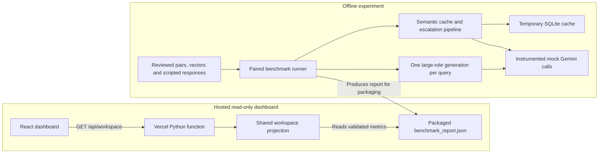

# Architecture

A page refresh reads a saved experiment. The Python handler validates the packaged report and returns metrics to React. The model calls, cache lookups, and evaluations represented by those metrics took place earlier in the offline benchmark.



The React application is deployed on Vercel. Locally, Vite serves the same API path by invoking the Python projection from the project virtual environment. Streamlit independently renders validated data from the dashboard loaders. The interactive CLI calls Gemini directly and maintains recent history and private long-term memory. Cache lookup, routing, and escalation are available as separate Python components and are exercised together by the benchmark. [React workspace client](../frontend/src/lib/workspace.ts) · [Local Vite middleware](../frontend/vite.config.ts) · [Benchmark runner](../benchmarks.py)

## A paired request through the benchmark

1. **Baseline.** Generate one scripted large-role answer. Time the request, then evaluate its answer outside the measured baseline interval. Each scenario sees the same eight routing fixtures twice, in the same order.
2. **Cache lookup.** Start the optimized scenario with an empty cache. A review must match the exact query and affirm context independence, non-sensitive content, time independence, and independence from external state. Eligible lookup embeds the query with the `SEMANTIC_SIMILARITY` task, normalizes the vector, and scores compatible, unexpired entries using a NumPy dot product. The highest score must meet the configured threshold. A final reread checks invalidation and expiry before returning an answer.
3. **Hit or generation.** A hit returns the stored answer and avoids an initial generation call. The benchmark still records lookup embedding work. On a miss, the classifier selects a role by query complexity. The shared model layer invokes that role once and keeps the instrumentation snapshot. The router records whether pricing is available. Complexity determines the initial role.
4. **Evaluate and escalate.** The deterministic evaluator uses criterion scores, blockers, and an acceptance threshold of 0.8 by default. A failing small answer can escalate once to a distinct large model. A passing second answer wins. If both fail, the higher score wins and a tie keeps the first. A provider or evaluator failure raises a structured error with available attempts.
5. **Store after review.** The paired benchmark saves an answer only after a passing evaluation and an explicit response review bound to the exact text. The response must be successful, non-sensitive, and free of a safety refusal. Saving can incur another embedding call. All generation attempts, lookup embeddings, and storage embeddings enter the optimized ledger.

The small and large roles can be configured with `GEMINI_SMALL_MODEL` and `GEMINI_LARGE_MODEL`. The cache threshold and version come from `CacheConfig`. Eligibility is supplied by a trusted caller. A namespace scopes data and invalidation. Applications sharing a namespace share entries. A similarity score or heuristic pass cannot establish that two queries deserve the same answer. [Cache contract](../semantic_cache.py) · [Routing policy](../model_router.py) · [Quality evaluator](../answer_evaluator.py) · [Escalation rules](../escalation.py)

## Cost, latency and quality

The generation recorder measures SDK call duration and reads SDK usage metadata. Prompt tokens include provider-cached input, so ordinary input must exclude that subset. In standard paid text pricing, the estimated USD amount is:

```text
((prompt − cached) × input_rate + cached × cached_rate + billed_output × output_rate) / 1,000,000
```

Billed output includes candidate and thought tokens. Where supported, consistent total and prompt counts can establish billed output while the raw thought count stays unknown. Embeddings use reported embedding token statistics. A local semantic hit avoids generation. The cached-input rate applies to cached tokens reported by the provider during an API call.

Money is calculated with Decimal and serialized as decimal strings. Explicit zero stays zero. Missing required usage, unsupported billing, or missing/expired pricing withholds a complete estimate. Known subtotals contain only priced requests. False or unreviewed cache hits also withhold monetary savings. Model overrides need their own rates. [Instrumentation](../instrumentation.py) · [Pricing snapshot](../model_pricing.json) · [Paired cost calculation](../cost_comparison.py)

The threshold experiment counts labeled query pairs, the routing experiment counts classified queries and model attempts, and the paired cost comparison uses all workload queries, including cache hits, as its denominator. These have different denominators. The paired latency projection uses local wall-clock measurements and nearest-rank percentiles. Lookup time includes local embedding and search work, so adding it to end-to-end latency would double-count time. Quality pass rates count the answers that passed the evaluator's criteria. [Performance projection](../latency_quality.py) · [Evaluation fixtures](../evaluation/)

## Monitoring API

The public function serves `GET` and `HEAD /api/workspace`. It accepts the filter names `from`, `to`, `model`, `currency`, and `rate`. Request parsing bounds the query length, field count, and value lengths. Historical filters do not change the saved synthetic experiment.

| Response | Meaning |
| --- | --- |
| `200` | Valid workspace JSON, or headers only for HEAD. Missing or invalid source files have explicit source states. |
| `400` | Malformed filter syntax, unknown or repeated fields, or exceeded filter limits. The error does not echo the input. |
| `405` | Unsupported method, including POST or DELETE. The response sets `Allow: GET, HEAD` and skips the projection. |
| `503` | Unexpected workspace failure. The body contains a generic message without exception or credential details. |

Responses set `Cache-Control: no-store` and `X-Content-Type-Options: nosniff`. The handler suppresses its own request-target logging. It returns selected metrics and configuration labels. Cached prompts, answers, vectors, credentials, raw reports and local request history stay outside the response. Hosting-platform log settings are managed separately. [API handler](../api/workspace.py) · [Shared projection](../frontend/workspace_data.py) · [HTTP contract tests](../tests/test_workspace_api.py)

| Data source | Where it appears | Interpretation |
| --- | --- | --- |
| Saved benchmark | Public and local dashboards | Synthetic outcomes and estimates from the bundled report |
| Local `request_metrics.jsonl` | Local dashboards when records exist | Validated historical API attempts, without a paired baseline or production savings figure |
| Live telemetry | No connected feed | Refresh rereads the available workspace; it never initiates model calls |
| Database configuration | System Information | `Configured` describes settings. `Not probed` describes connection status. |

## Deployment and verification boundary

[vercel.json](../vercel.json) builds from the repository root, packages the benchmark for the function, and publishes only the React build directory as static assets. [The upload allowlist](../.vercelignore) excludes private logs, local databases, memory and environment files. The API uses project modules and the Python standard library. Its [runtime manifest](../pyproject.toml) declares no third-party dependencies. The public demo and workspace JSON endpoint have been verified over HTTP.

For local development, storage defaults to SQLite. Selecting `LCR_DATABASE_BACKEND=postgresql` enables the optional Psycopg adapter. Server-side `LCR_POSTGRES_DSN` supplies the connection settings. The adapter requires verified TLS, disables automatic prepared statements, and uses short transactions with timeouts. PostgreSQL migrations 001 and 002 preserve full query keys and add a scoped SHA-256 digest index with exact-key collision checks. [Storage configuration and migration details](database.md)

The PostgreSQL adapter has offline coverage for rollback, conflicts, corruption, isolation and expiry. The real integration test requires a disposable `lcr_adapter_test` database on `127.0.0.1` with trusted TLS. The local PostgreSQL 17 listener declined TLS at the last check. Real migration and concurrency verification, hosted connectivity, effective Supabase role grants and private-schema exposure remain open. Lookup still scans the eligible scope in memory. The deployed read-only dashboard is independently usable while those checks are pending.
